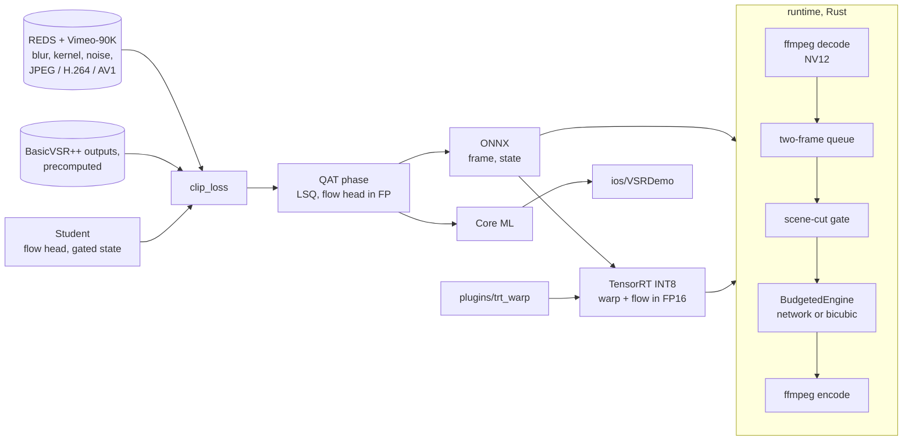

# vsr-mobile

[](https://github.com/hanaml-lab/vsr-mobile/actions/workflows/ci.yml) [](LICENSE)

Video super-resolution on the device that plays the video: 270p to 1080p, x4 in each direction. The student
network has about 1.9 million parameters and sees only the current and previous frames, so it adds no latency to
playback. It carries a 16-channel hidden state forward in time, warped by a small optical-flow head; where the flow
is unreliable (a cut, fast motion, an occlusion) a confidence gate drops that state instead of smearing the old frame
into the new one. The repository holds distillation from precomputed teacher outputs (the configs read BasicVSR++'s),
quantisation-aware fine-tuning, ONNX, TensorRT INT8 and Core ML exports, and a Rust playback pipeline with a
frame-time budget. It is the system repo behind the [`vsr-lite`](https://hanaml.com/models/vsr-lite) model, and it
carries the training terms of the [DRIFT](https://hanaml.com/research/papers/ondevice-video-sr) paper into
production. DRIFT's own student, distilled from a one-step video diffusion teacher, stays in the paper repo.

| Component | Language | What it does |
| --- | --- | --- |
| [`train`](train) | Python, PyTorch | The causal student and its flow head; REDS and Vimeo-90K clips with blur, downscaling-kernel, noise and JPEG, H.264 or AV1 degradations; distillation with reconstruction and temporal losses, or DRIFT's terms; LSQ quantisation-aware fine-tuning. |
| [`export`](export) | Python | ONNX with exactly two inputs, `frame` and `state`; a TensorRT INT8 engine with the warp and the flow head in FP16; a Core ML package. |
| [`runtime`](runtime) | Rust | The playback pipeline: ffmpeg decode, NV12 frames read in place, a two-frame queue, scene-cut resets, a frame-time budget with a bicubic fallback, encode. |
| [`plugins`](plugins) | C++ (CUDA) | A TensorRT plugin that keeps the backward warp in FP16 when the rest of the engine is INT8. |
| [`ios/VSRDemo`](ios/VSRDemo) | Swift | A SwiftUI demo that runs the Core ML package on an iPhone, carrying the hidden state from frame to frame. |

## Install

```bash
pip install torch --index-url https://download.pytorch.org/whl/cpu   # or a CUDA build
pip install -e ".[train,export]"
cargo build --release -p vsr-runtime --features onnx                 # the playback pipeline, with ONNX Runtime
```

The pipeline and the codec degradations call `ffmpeg` and `ffprobe` (with libx264 and libaom-av1). TensorRT 10 is
needed only on the Jetson (`".[tensorrt]"`), `coremltools` only for the iOS export (`".[coreml]"`).

## Quickstart

The whole path on a laptop, with no data and no GPU: a short distillation run on synthetic clips, ONNX export, and
the Rust pipeline upscaling a generated 270p clip to 1080p. The model it trains only shows that the plumbing works.

```bash
examples/smoke.sh
```

```text
50 frames, 0 scene resets, 0 fallback frames, sustained 8227.2 ms/frame over the last 300
1920,1080
```

The frame time is the full-size student on a shared CPU through ONNX Runtime; it says nothing about the device.

With trained weights, a local `.pt` state dict (`Student.from_pretrained` also takes a Hugging Face repo id, for
when the `vsr-lite` weights are published):

```bash
python -m export.onnx --weights runs/student.pt --out vsr.onnx
cargo run --release -p vsr-runtime --features onnx -- --model vsr.onnx \
    --input clip_270p.mp4 --output clip_1080p.mp4 --frame-budget-ms 33   # bicubic for 30 frames after an overrun

# on a Jetson Orin Nano: an INT8 engine, calibrated on held-out footage
python -m export.tensorrt --onnx vsr.onnx --int8 --calib data/calib/ --out vsr.plan --plugin build/plugins/libtrt_warp.so
```

```python
from train.student import Student

model = Student.from_pretrained("runs/student.pt").eval()
state = None
for frame in frames:                    # (1, 3, h, w) tensors in [0, 1], h and w at least 8
    upscaled, state = model(frame, state)
```

Training reads precomputed BasicVSR++ outputs laid out beside REDS and Vimeo-90K (paths in the configs):

```bash
python -m train.distill --config configs/student-x4.yaml         # the vsr-lite recipe
python -m train.distill --config configs/student-x4-drift.yaml   # DRIFT's terms, then an 8-bit QAT phase
```

## Architecture



- **Student** (`train/student.py`). Features of the new frame plus the previous hidden state, warped by a three-level
  flow pyramid in the style of RAFT's update block. The state holds the previous low-res frame and 13 feature
  channels, so every export has exactly two inputs, `frame` and `state`. A per-pixel confidence from the flow head
  scales the warped state; below a mean confidence of 0.35 the state is dropped.
- **Data** (`train/data.py`). REDS clips and Vimeo-90K septuplets, degraded on the fly: blur, one of three
  downscaling kernels, noise, then JPEG per frame or H.264 or AV1 over the whole clip through ffmpeg, in YUV 4:2:0 as
  real streams are.
- **Losses** (`train/distill.py`, `train/drift.py`). The `vsr-lite` recipe: Charbonnier distance to the teacher and to
  ground truth, and a temporal term on consecutive outputs warped by the student's flow, weighted by its confidence.
  The DRIFT recipe replaces the temporal term with consistency matching (agree with the teacher's flow-compensated
  temporal residual rather than suppress all change), adds a gradient-domain texture term against the teacher, and
  penalises a state-Jacobian spectral norm above γ = 0.9, estimated by power iteration.
- **Quantisation** (`train/qat.py`, `export/tensorrt.py`). LSQ fake quantisation of weights (per channel) and conv
  inputs (per tensor) everywhere but the flow head, which the TensorRT engine keeps in FP16 together with the warp.
  `freeze` snaps the weights to their grid; activation ranges on the device come from entropy calibration on
  held-out footage.
- **Runtime** (`runtime/src`). Decoding, inference and encoding run on three threads joined by channels of depth two.
  A luma-histogram gate clears the state at hard cuts. With `--frame-budget-ms`, a frame that overruns the budget
  sends the next `--fallback-frames` frames (30 by default) to bicubic with the features cleared, then the network is
  tried again.

## Results

### Reproduced by this repo

`examples/smoke.sh` checks the plumbing, not quality: 50 generated 270p frames go through a student trained for 20
steps, in ONNX Runtime, and come out as 1920 x 1080 video with no scene resets and no fallback frames; the frame time
it prints depends on the machine. `pytest` (25 tests) checks the parameter budget (1.7M to 2.1M), the warp, the gate,
the codec degradations (more loss at CRF 45 than at CRF 18), the power-iteration norm on maps with known singular
values, DRIFT's bound against worked values, LSQ rounding and clipping, and that ONNX Runtime reproduces PyTorch to
1e-4. `cargo test` (8 tests) checks NV12 conversion, the queue's order, scene-cut resets and the frame-time budget.

### Reported in the paper

The [DRIFT](https://hanaml.com/research/papers/ondevice-video-sr) paper reports these numbers for its own student: a
1.9M-parameter recurrent network distilled from DOVE, a one-step video diffusion model, and run in W8A8 on a
Snapdragon 8 Gen 3 NPU. That student, its gated update and its long-rollout state bank are in the paper repo. This
repo borrows DRIFT's loss terms and LSQ but keeps its own student and teacher, and no paper measures `vsr-lite`.

| Metric | Baseline | DRIFT | Setting |
| --- | --- | --- | --- |
| Latency per frame, 270p to 1080p | 118.0 ms | 21.4 ms | Snapdragon 8 Gen 3 NPU via QNN, median of 1,000 frames; RealBasicVSR, the only other model that runs on the NPU |
| VideoLQ DOVER (higher is better) | 0.672 | 0.729 | RealBasicVSR vs. DRIFT W8A8; the 5.6B DOVE teacher scores 0.748 |
| DOVER drop after 1,000 frames (lower is better) | 0.137 | 0.005 | LongLQ; min–max post-training quantisation vs. DRIFT, both W8A8; FP16 reference 0.006 |
| Warping error, REDS30 (×10⁻³, lower is better) | 5.21 | 2.83 | RealBasicVSR vs. DRIFT W8A8; the teacher scores 2.95 |
| 2AFC preference for DRIFT over RealBasicVSR | 50% | 74.6% | 24 raters × 40 clips on a phone display; parity as the baseline; 95% CI 69.7–79.1% |
| PSNR, REDS4 bicubic ×4, trained with ℓ1 alone | 31.42 dB | 30.84 dB | Bidirectional BasicVSR (6.3M parameters) vs. the same student architecture in FP16; 30.71 dB in W8A8 |

## Papers

| Date | Paper | What this repo implements | PDF | Paper repo |
| --- | --- | --- | --- | --- |
| 2025-11-12 | [DRIFT: Drift-Bounded Distillation of One-Step Video Diffusion into Integer Recurrent Students](https://hanaml.com/research/papers/ondevice-video-sr) | The contraction penalty with its power-iteration norm, consistency matching, the gradient-domain texture term, LSQ quantisation-aware training and the drift bound, applied to the production student (`configs/student-x4-drift.yaml`). The gated contractive update, the long-rollout state bank and the one-step diffusion teacher stay in the paper repo. | [PDF](https://hanaml.com/papers/ondevice-video-sr.pdf) | [ondevice-video-sr](https://github.com/hanaml-lab/ondevice-video-sr) |

## Models

- [`vsr-lite`](https://hanaml.com/models/vsr-lite): the 1.9M-parameter student this repo trains, distilled from
  precomputed BasicVSR++ outputs with quantisation-aware training, for INT8 on a Jetson Orin Nano, ONNX Runtime or
  Core ML. No paper measures it; DRIFT's reported numbers belong to DRIFT's own student.

## Development

```bash
pip install -e ".[train,export,dev]"
pytest                    # the codec tests skip when ffmpeg lacks libx264 or libaom-av1
ruff check .
cargo fmt --all --check && cargo clippy --all-targets --features onnx -- -D warnings && cargo test
```

CI runs the Python tests and lint, the Rust format check, lint and tests, and `examples/smoke.sh`. The TensorRT
plugin and the iOS demo need CUDA with TensorRT, and Xcode; they are built on the target devices, not in CI:

- `cmake -S plugins -B build/plugins -DTENSORRT_ROOT=/usr && cmake --build build/plugins` on a Jetson (JetPack 6).
- The iOS demo is three Swift files: add them to a new iOS 17 app target in Xcode, with `VSRLite.mlpackage`
  (`python -m export.coreml --weights runs/student.pt --out VSRLite.mlpackage`) and a 270p `demo.mp4` in the bundle.

## Contributing

See [CONTRIBUTING.md](CONTRIBUTING.md).

## Citation

```bibtex
@software{hanaml_vsr_mobile_2026,
  author  = {{hanaML}},
  title   = {vsr-mobile: on-device video super-resolution from 270p to 1080p},
  year    = {2026},
  version = {0.6.0},
  url     = {https://github.com/hanaml-lab/vsr-mobile}
}
```

If you use the DRIFT training terms, please also cite the paper:

```bibtex
@techreport{agarwal2025drift,
  author      = {Agarwal, Manav},
  title       = {{DRIFT}: Drift-Bounded Distillation of One-Step Video Diffusion into Integer Recurrent Students},
  institution = {hanaML},
  type        = {Technical report},
  year        = {2025},
  url         = {https://hanaml.com/research/papers/ondevice-video-sr}
}
```

[`CITATION.cff`](CITATION.cff) has the same in machine-readable form.

## Licence

Apache-2.0. See [`LICENSE`](LICENSE). Teacher weights keep their own licence and are not redistributed.
